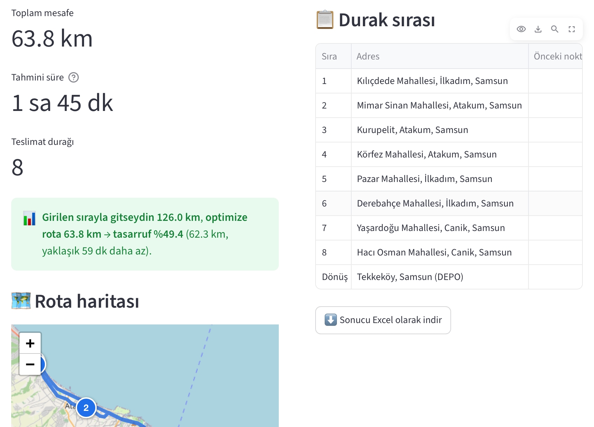

# 🚚 Teslimat Rota Planlayıcı


[](https://teslimat-rota-planlayici.streamlit.app)

Bir depodan çıkıp **3–15 teslimat adresine** uğrayan ve depoya geri dönen **en kısa rotaları**, **araç kapasitesini aşmadan** hesaplayan web uygulaması. Filo **farklı kapasiteli araçlardan** (ör. kamyon + kamyonet) oluşabilir.
Python + Streamlit ile yazıldı; **tamamen ücretsiz** servisler kullanır, **API anahtarı gerekmez**.

🔗 **Canlı demo:** [teslimat-rota-planlayici.streamlit.app](https://teslimat-rota-planlayici.streamlit.app)

## 📸 Ekran görüntüsü



## 🎯 Ne işe yarar?

Kurye veya dağıtım aracının adresleri **yazıldığı sırayla** gezmesi çoğu zaman gereksiz kilometre demektir.
Bu uygulama:

- Adresleri haritada bulur,
- Noktalar arasındaki **gerçek yol mesafelerini** hesaplar,
- Adresleri **her aracın kendi kapasitesine (kg) göre** araçlara paylaştırır (karışık filo: kamyon, kamyonet, panelvan…) ve her aracın **en kısa ziyaret sırasını** bulur,
- Her aracın **yükünü ve doluluk oranını** gösterir,
- Sonucu haritada numaralı duraklarla, tabloda ve Excel dosyasında verir,
- "Girilen sırayla gitseydin **X km**, optimize rota **Y km**, tasarruf **%Z**" karşılaştırmasıyla kazancı gösterir.

**Samsun örneği** (uygulama açılışta bununla gelir): İlkadım Sanayi Sitesi deposundan Atakum, İlkadım ve Tekkeköy'deki 7 noktaya
toplam **1380 kg** teslimat, durak başı 5 dk teslim süresi. Tüm konumlar koordinatlıdır ve haritada doğrulanmıştır.
Açılıştaki filo karışıktır: **1 × Kamyon (1000 kg) + 2 × Kamyonet (600 kg)**.

Aşağıdaki sonuçlar **tek tip filo** (3 × 800 kg) ile, gerçek yol verisiyle (OSRM) hesaplandı:

| | Elle planlama (girilen sıra) | Optimize plan |
|---|---|---|
| Toplam mesafe | 123,6 km | **69,8 km** |
| Sefer / araç sayısı | 3 sefer | **2 araç** |
| Ortalama doluluk | %58 | **%86** |

→ **%43,5 daha az km** (53,8 km), **1 sefer (araç) daha az** ve toplam araç süresinde yaklaşık **52 dakika** tasarruf.
Optimize planda bir araç Atakum sahil hattını, diğeri Tekkeköy ile İlkadım'ı alır; en uzun tur 52 dakikadır.

## ⚙️ Nasıl çalışır? (adım adım mantık)

```
Adresler ──► 1. Geocoding ──► 2. Mesafe matrisi ──► 3. Optimizasyon ──► 4. Sonuç
            (Nominatim)       (OSRM)                (OR-Tools)           (harita, tablo, Excel)
```

**1. Adres → koordinat (`geocoding.py`)**
"Körfez Mahallesi, Atakum, Samsun" gibi bir metni OpenStreetMap **Nominatim** servisiyle enlem/boylama çeviririz.
Nominatim bulamazsa veya cevap vermezse aynı soru OSM tabanlı ikinci ücretsiz servis **Photon**'a (Türkiye sınırlarıyla) sorulur.
Adres yerine doğrudan **koordinat** ya da okunur bir isimle `Kurupelit, Atakum (41.3640, 36.2200)` yazılabilir; o zaman hiçbir servise gidilmez.
Tanınan biçimler: `41.2867, 36.33` · `(41.2867, 36.33)` · `41,2867, 36,33` (virgüllü ondalık) · `41°17'12.1"N 36°19'48.0"E` (Google Haritalar'ın dereceli biçimi).

**Yanlış konum kontrolü:** Bir nokta Türkiye sınırları dışına ya da diğer noktalardan 150 km'den uzağa düşerse uygulama uyarır
(ör. belirsiz bir adres başka bir ilde bulunduğunda). Enlem ile boylam ters yazılmış gibi görünüyorsa bunu da ayrıca belirtir.
Servislerin kullanım kurallarına uyarız: her istekte uygulamayı tanıtan bir **User-Agent** gönderilir, **saniyede en fazla 1 istek** atılır,
"yoğunum" (HTTP 429) cevabında 2 sn ve 4 sn bekleyip tekrar denenir ve sonuçlar **önbelleğe** (bellek + JSON dosyası) alınır; aynı adres ikinci kez sorulmaz.

**2. Mesafe matrisi (`mesafe.py`)**
N nokta için N×N'lik bir tablo oluştururuz: `matris[i][j]` = i noktasından j noktasına **gerçek yol mesafesi** (km) ve **süresi** (dk).
Bunu **OSRM** `/table` servisi tek istekte verir. Tek yönlü yollar yüzünden A→B ile B→A farklı olabilir; model bunu doğal olarak destekler.
OSRM'e ulaşılamazsa uygulama durmaz: kuş uçuşu mesafe (Haversine formülü) × 1,3 yol katsayısıyla **tahmini** değer kullanır ve ekranda uyarır.

**3. Araç rotaları (`optimizasyon.py`)**
Tek araçta bu, lojistikte meşhur **Gezgin Satıcı Problemi**dir (TSP). Birden fazla araç ve kapasite sınırı eklenince **Kapasite Kısıtlı Araç Rotalama Problemi (CVRP)** olur:
adresleri araçlara paylaştır, hiçbir aracın yükü kapasitesini aşmasın, **toplam km en az** olsun.
15 adreste yalnızca sıralama ihtimali 15! ≈ **1,3 trilyon** olduğundan hepsini denemek pratik değildir.
Google **OR-Tools** önce hızlı bir başlangıç çözümü kurar (*Path Cheapest Arc*: her adımda en ucuz bağlantıyı seç), sonra *Guided Local Search* ile bu çözümü birkaç saniye boyunca iyileştirir.
Kapasite, OR-Tools'ta bir **boyut (dimension)** olarak tanımlanır: rota boyunca yük birikir ve her araçta kapasiteyi aşamaz.
**Karışık filo:** Her aracın kapasitesi ayrı ayrı verilir (ör. `[1000, 600, 600]`); böylece ağır yük kamyona, hafif turlar kamyonete düşer.
Doluluk oranı her aracın kendi kapasitesine göre hesaplanır. Aynı tip araçlar birbirinin aynısı olduğundan kullanılanlar sırayla numaralanır.
**"Araç sayısını en aza indir"** seçeneği (varsayılan açık) her kullanılan araca, olası tüm km'lerin toplamından büyük bir **sabit maliyet** ekler.
Böylece model önce araç sayısını, sonra km'yi en aza indirir. Kapalıyken yalnızca km'ye bakılır; depo şehir merkezindeyse bu, yarı boş bir aracın
yakındaki tek bir durağa gönderilmesine yol açabilir. Gerçekte fazladan araç + şoför, birkaç km'den çok daha pahalıdır.
Küçük örneklerde sonucun, tüm olasılıkları deneyen kaba kuvvet yöntemiyle **aynı optimumu** bulduğu testlerle doğrulanmıştır.

**Karşılaştırma ("girilen sıra") nasıl hesaplanır?** Elle planlamayı taklit eder: adresler yazıldığı sırayla araca yüklenir,
sıradaki adres sığmıyorsa araç depoya döner ve yeni araç başlar. Optimize plan bununla km ve araç sayısı olarak kıyaslanır.

**4. Sonuç (`app.py`, `rapor.py`)**
- **folium** haritasında depo (kırmızı **D**), her araç **ayrı renkte** rota çizgisi ve sıra numaralı duraklar
- Araç tablosu: durak sayısı, yük (kg), **doluluk %**, km ve süre
- Durak sırası tablosu: araç, teslim edilen ve araçta kalan yük, her bacağın km/dk değeri, kümülatif toplamlar
- Özet kartları: toplam km, kullanılan araç, ortalama doluluk, en uzun tur süresi (sürüş + durak başı teslim süresi)
- Girilen sıra ile optimize planın karşılaştırması
- Üç sayfalı (Özet + Araçlar + Durak Sırası) **Excel** indirme

## 📁 Proje yapısı

| Dosya | Görevi |
|---|---|
| `app.py` | Streamlit arayüzü; diğer modülleri sırayla çağırır, girdi ve konum uyarılarını gösterir |
| `harita.py` | folium haritası (araç başına renkli rota, numaralı duraklar; metinler HTML kaçışıyla güvenli) |
| `geocoding.py` | Adres → koordinat (Nominatim, yedek Photon), hız sınırı, tekrar deneme, önbellek |
| `mesafe.py` | OSRM mesafe/süre matrisi, rota çizgisi, çevrimdışı tahmin |
| `optimizasyon.py` | OR-Tools ile kapasiteli araç rotaları (CVRP), girilen sıra planı, tasarruf hesabı |
| `rapor.py` | Araç özeti, durak tablosu ve Excel dosyası |
| `ornek_veriler.py` | Hazır Samsun depo/adresleri, talepler, araç ayarları ve yedek koordinatlar |
| `tests/` | pytest birim testleri + Streamlit AppTest ile uçtan uca arayüz testleri (ağ çağrıları taklit edilir, internetsiz çalışır) |

## 💻 Kurulum (kendi bilgisayarında)

Gereksinim: **Python 3.10+**

```bash
git clone https://github.com/baduone03/teslimat-rota-planlayici.git
cd teslimat-rota-planlayici

python -m venv .venv
# Windows:      .venv\Scripts\activate
# macOS/Linux:  source .venv/bin/activate

pip install -r requirements.txt
streamlit run app.py
```

Tarayıcıda `http://localhost:8501` açılır. Soldaki örnek adreslerle doğrudan **Rotayı Hesapla**'ya basabilirsiniz.

## 🧪 Testler ve kalite kontrolü

```bash
pip install -r requirements-dev.txt
pytest --cov            # tüm testler + kod kapsamı
ruff check .            # kod kalitesi
```

| Katman | Ne yapar | Nerede |
|---|---|---|
| **Birim testleri** | Her modülü tek başına sınar (ör. koordinat okuma, kapasite kısıtı, Excel çıktısı). Ağ çağrıları taklit edilir. | `tests/test_*.py` |
| **Uçtan uca arayüz testleri** | Streamlit **AppTest** ile uygulamayı tarayıcısız çalıştırır: butona basar, girdi değiştirir, uyarı ve hataları kontrol eder. | `tests/test_app.py` |
| **Özellik tabanlı testler** | **Hypothesis** yüzlerce rastgele senaryo üretir ve kuralların hiç bozulmadığını kontrol eder: kapasite aşılmaz, her durak bir kez ziyaret edilir, optimize plan elle plandan uzun olmaz, tek araçta sonuç kaba kuvvetle bulunan kesin optimuma eşittir. | `tests/test_ozellikler.py` |
| **Canlı duman testleri** | GitHub Actions **her gün** gerçek Nominatim, Photon ve OSRM servislerini ve yayındaki uygulamayı bir tarayıcıyla (Playwright) dener. Bir servis bozulursa e-postayla haber verir; yan etki olarak uygulamayı uyku modundan uzak tutar. | `tests_canli/` |
| **Kod kalitesi** | **ruff** ile stil ve olası hata kontrolü; kod kapsamı **%90'ın altına düşerse** CI başarısız olur (şu an ~%97). | `.github/workflows/testler.yml` |

## 🧰 Kullanılan teknolojiler (hepsi ücretsiz)

| Teknoloji | Kullanım |
|---|---|
| [Streamlit](https://streamlit.io) | Web arayüzü |
| [OpenStreetMap Nominatim](https://nominatim.org) + [Photon](https://photon.komoot.io) | Adres → koordinat |
| [OSRM](https://project-osrm.org) | Gerçek yol mesafesi, süre ve rota çizgisi |
| [Google OR-Tools](https://developers.google.com/optimization) | Rota optimizasyonu (TSP / CVRP) |
| [folium](https://python-visualization.github.io/folium/) | Etkileşimli harita |
| pandas + openpyxl | Tablo ve Excel çıktısı |

## ⚠️ Bilinen sınırlar ve geliştirme fikirleri

- Nominatim ve OSRM'in **ücretsiz demo sunucuları** kullanılıyor; yoğun/ticari kullanım için kendi sunucunuzu kurmanız gerekir.
- Süreler **serbest akış** trafiğine göredir; anlık trafik dahil değildir.
- Optimizasyon **sezgisel** bir yöntemdir (OR-Tools birkaç saniye arar): sonuç çok iyidir ama 15 adreste kanıtlanmış en iyi
  çözüm olduğu garanti edilmez. Küçük örneklerde kesin optimumu bulduğu testlerle doğrulanmıştır.
- Bir araç günde **tek sefer** yapar; yük filoya sığmazsa ikinci sefer planlanmaz, uygulama araç eklemenizi ister.
- Araç başına **mesai süresi sınırı** yoktur; uzun turlar için "En uzun tur" değerini kontrol edin.
- Tek bir yük birimi (kg) kullanılır. OR-Tools'un desteklediği şu özellikler kolayca eklenebilir:
  - İkinci bir yük boyutu (desi/hacim) ve araç tipine göre km maliyeti (kamyon km'si kamyonetten pahalı)
  - **Zaman pencereleri** (VRPTW — "müşteri 10:00–12:00 arası")
  - Araç başı **maksimum mesai süresi** ve TL cinsinden gerçek maliyet (yakıt + şoför) ile planlama
- Adresler CSV/Excel'den toplu yüklenebilir.

## 🚀 Streamlit Community Cloud'a ücretsiz yayınlama

1. Kodun GitHub'da **public** (herkese açık) bir repoda olduğundan emin olun.
2. [share.streamlit.io](https://share.streamlit.io) adresine gidin ve **"Continue with GitHub"** ile giriş yapın; istenen izinleri onaylayın.
3. Sağ üstten **"Create app"** → **"Deploy a public app from GitHub"** seçin.
4. Formu doldurun:
   - **Repository:** `baduone03/teslimat-rota-planlayici`
   - **Branch:** `main`
   - **Main file path:** `app.py`
   - **App URL:** isterseniz `teslimat-rota-planlayici` gibi akılda kalıcı bir ad yazın
5. **Advanced settings** → **Python version** olarak **3.12** veya **3.13** seçin.
6. **Deploy** butonuna basın. İlk kurulum `requirements.txt`'teki paketleri yüklediği için birkaç dakika sürer.
7. Uygulama açılınca örnek adreslerle **Rotayı Hesapla**'yı deneyin ve linki README'ye ekleyin.

**Notlar:**
- `main` dalına her push yaptığınızda uygulama otomatik güncellenir.
- Ücretsiz planda uygulama bir süre kullanılmazsa uyku moduna geçer; ilk ziyaretçi "Yes, get this app back up" butonuyla uyandırır (~30 sn).
- Hiçbir API anahtarı veya "secret" tanımlamanız gerekmez.

## 📄 Lisans

MIT
